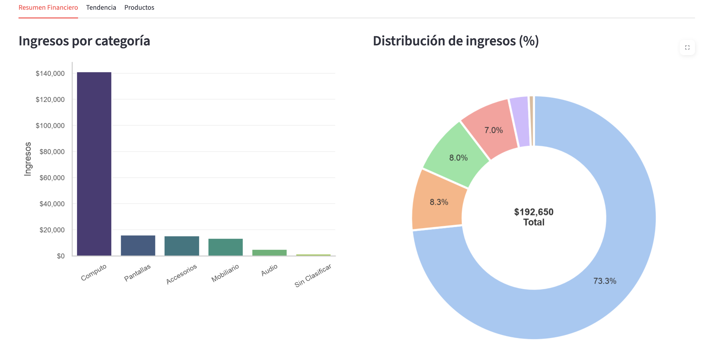

# Electronics Store Sales Dashboard

Interactive sales dashboard built with **Python + Streamlit** to analyze revenue, order trends and top products for an electronics store.



## What it shows

| Tab | Visualization | Business question |
|---|---|---|
| **Financial Summary** | Revenue by category (bar) + revenue share (donut) | Which categories drive the business? |
| **Trend** | Daily orders with 7-day moving average, peak-day annotation and KPI cards | How is order volume evolving? |
| **Products** | Top N products by sales (horizontal bar) | Which products should we prioritize? |

## Highlights

- **Clean data pipeline:** dates parsed once, cached loading with `@st.cache_data`.
- **Accurate time series:** days with zero orders are filled (`asfreq('D')`) so the trend line doesn't skip dates.
- **Consistent design:** shared color palette and a reusable `estilo_limpio()` helper for minimalist axes.
- **Readable charts:** integer axes for counts, currency formatting, value labels and legends instead of overlapping text.

## Tech stack

Python · pandas · matplotlib · seaborn · Streamlit

## Run it locally

```bash
git clone https://github.com/davidricorulo-ai/Dashboard.git y cd Dashboard
cd dashboard-tienda-electronica
pip install -r requirements.txt
streamlit run app.py
```

## Data

`ventas_limpias.csv` contains the cleaned sales dataset (one row per order line) with the columns:
`ID_Pedido`, `Fecha`, `Categoria`, `Producto`, `Subtotal`.

The raw data was cleaned beforehand in Google Colab (pandas).

## Project structure

```
├── app.py                 # Streamlit app
├── ventas_limpias.csv     # Cleaned dataset
├── requirements.txt
└── docs/
    └── screenshot.png     # Preview used in this README
```

---

**Author:** David Rico · Business Analyst — Finance Operations & Automation
